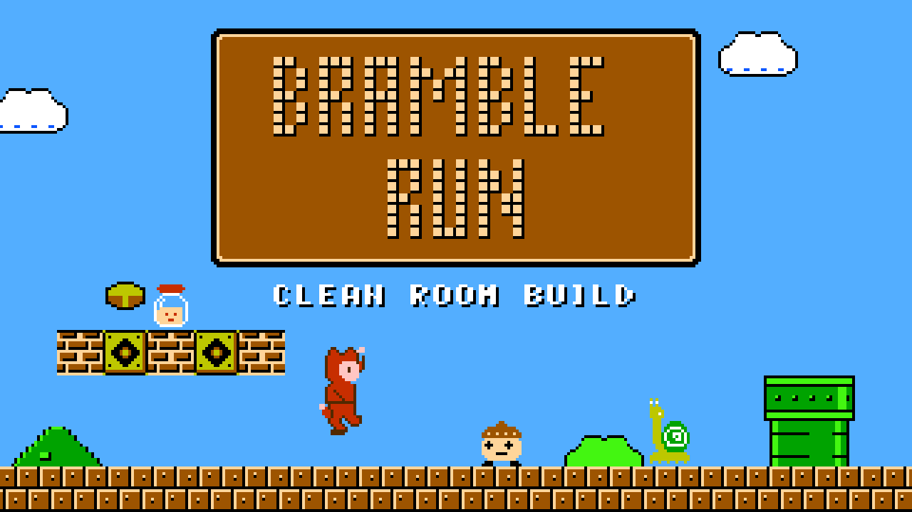

# Bramble Run

**Play:** https://andrewnakas.github.io/smb-cleanroom/



An original NES platformer built on the **smb1 disassembly** (doppelganger's community disassembly, in the asm6f form
kept at [Xkeeper0/smb1](https://github.com/Xkeeper0/smb1)). The program is assembled from that source; everything
the player sees and hears is new: FENN the fox-hooded courier (player 2: MOSS) runs eight routes of generated
stages to reach QUEEN WREN, held by the wind-up KING KLINKER. It runs in the page on EmulatorJS (FCEUmm core).
No original game file is needed or shipped.

| Part | Kept (structure / anchors only) | New |
|---|---|---|
| Program | the disassembly's code | assembled with asm6f |
| Stages (34 area slots) | kind, timer, entrance, page count, warp-portal anchors, castle-end anchors | layouts from a seeded generator (`games/smb/levelgen.py`), cleared by a headless bot (32/32 main-path stages) |
| Pictures, font, title | picture sizes | every tile drawn here (`games/smb/art/`, `bg_art.py`, `font.py`, `title.py`) |
| Palettes | index roles the code uses | colours picked here (`palettes.py`) |
| Music and effects | frequency table, header layout | 16 songs composed by `cleanroom.audio.compose`, new effect tables (`music.py`) |
| Text | string slots and lengths | every word rewritten (`text.py`) |

Gates, both 0 failing: [ORIGINALITY.md](ORIGINALITY.md) (music, text, tilemaps, images, code) and
[TAINT.md](TAINT.md) (raw windows, tiles, pictures, title script, palettes, and every 16-byte program window that
equals the original must come from the assembled code).

## Rebuild

```
python -m games.smb.extract_spec <your ROM>        # dirty room, once: structural facts + gate exports
sh tools/publish.sh                                # generate, assemble, gates, build the site
python ports/wasm/serve.py D:/n64work/smb/site 8481
```

The gate's original-name list (`games/smb/names.json`) is a dirty-room file and is not part of this repository.

## Licences

Code in this repository: MIT (`LICENSE`). The site bundles EmulatorJS (GPL-3.0) and the libretro FCEUmm core
(GPL-2.0); see `THIRD_PARTY.md` on the site. An unofficial fan project, not affiliated with any publisher.
